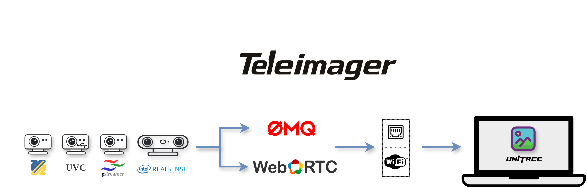

<div align="center">
  
  <a href="https://www.unitree.com/" target="_blank">
    
  </a>
  <p align="center">
    <a> English </a> | <a href="README_zh-CN.md">中文</a>
  </p>
  <p align="center">
    <a href="https://github.com/unitreerobotics/xr_teleoperate/wiki" target="_blank"> </a> <a href="https://discord.gg/ZwcVwxv5rq" target="_blank"> <a href="https://deepwiki.com/unitreerobotics/teleimager"></a> </a>
  </p>
</div>

[**TeleImager**](https://github.com/unitreerobotics/teleimager) is Unitree's image service: a **server** captures video from multiple cameras (UVC, V4L2, GStreamer, RealSense, etc.) and publishes it over the network via **ZeroMQ** or **WebRTC**, while a **client** subscribes and decodes those streams. It powers the teleoperation video pipeline of [xr_teleoperate](https://github.com/unitreerobotics/xr_teleoperate).

## ✨ Features

- 📸 Multiple UVC / V4L2 / GStreamer / Intel RealSense cameras
- 📢 Publish frames over **ZeroMQ PUB-SUB** (high quality, LAN) and **WebRTC** (low latency, browser)
- 💬 Serve image-config commands over **ZeroMQ REQ-REP**
- 🆔 Five camera identifiers: physical path, serial number, bcd_device, vid_pid, video path
- ⚙️ Configurable resolution and frame rate
- 🚀 Efficient frame handoff via a triple ring buffer

---

## 1. 📦 Installation

TeleImager has **two roles** — install only what you need:

| Role | What it does | Where it runs |
|------|--------------|---------------|
| **Client** | Subscribes and decodes streams (teleoperation, data recording, your own CV code) | Workstation / robot host |
| **Server** | Captures from cameras and publishes over ZMQ/WebRTC | The robot/device the cameras are plugged into |

### 1.0 System prerequisite (both roles)

Both roles do JPEG encode/decode through **PyTurboJPEG**, a ctypes binding that loads the system library **libjpeg-turbo (3.0+ required)** at import. pip cannot install this native library — do it once per machine. Pick one:

**Method 1 — Conda (recommended, cross-platform)**

```bash
conda install -c conda-forge libjpeg-turbo
```

**Method 2 — Homebrew (macOS)**

```bash
brew install jpeg-turbo
```

<details>
<summary><b>Method 3 — Build from source (Ubuntu/Debian)</b></summary>

```bash
git clone https://github.com/libjpeg-turbo/libjpeg-turbo.git
cd libjpeg-turbo && mkdir build && cd build
cmake -DCMAKE_INSTALL_PREFIX=/opt/libjpeg-turbo ..
make -j$(nproc) && sudo make install
echo 'export LD_LIBRARY_PATH=/opt/libjpeg-turbo/lib64:$LD_LIBRARY_PATH' >> ~/.bashrc
source ~/.bashrc
```

</details>

> ⚠️ Do **not** install the PyPI package named `turbojpeg` — it is a different, incompatible library. This project uses `PyTurboJPEG` (already pulled in by `pip install teleimager`).
> Ubuntu's `sudo apt install libturbojpeg` is often older than 3.0, so it's not recommended. If the library is missing, TeleImager raises a detailed install hint equivalent to the above on first import.

### 1.1 Environment (conda)

```bash
# Install Miniconda (skip if already installed). Use the aarch64 installer on Jetson/ARM.
mkdir -p ~/miniconda3
wget https://repo.anaconda.com/miniconda/Miniconda3-latest-Linux-x86_64.sh -O ~/miniconda3/miniconda.sh
bash ~/miniconda3/miniconda.sh -b -u -p ~/miniconda3 && rm ~/miniconda3/miniconda.sh
source ~/miniconda3/bin/activate && conda init --all

# Create and activate the project environment
conda create -n teleimager python=3.10 -y
conda activate teleimager
```

### 1.2 Client install

| You need | Command |
|----------|---------|
| **Headless** — subscribe ZMQ → BGR `ndarray` (feed your own code) | `pip install teleimager` |
| **+ Viewer** — on-screen OpenCV windows | `pip install "teleimager[viewer]"` |

> The viewer pulls in `opencv-python`.

### 1.3 Server install

Pick the driver(s) for your cameras, run one install command, then add certificates at the end if you use WebRTC.

#### 1.3.1 Choose your backend (camera driver)

A *backend* is the capture driver TeleImager uses to talk to a camera. They're lazily loaded, so unused ones cost nothing; start from the base (V4L2 + WebRTC) and stack on what you have:

| Backend (camera driver) | pip extra | Notes |
|---------|-----------|-------|
| Base (V4L2) | `[server]` | Needs `v4l2-ctl`: `sudo apt install -y v4l-utils` |
| + UVC | `[uvc]` | Needs USB access — run `sudo "$(which teleimager-server)" --setup-permissions` once; the wheel already bundles `libturbojpeg` and `libusb`, no apt needed |
| + RealSense | `[realsense]` |  |
| + Everything (except GStreamer) | `[all]` | Equivalent to UVC + RealSense |
| + GStreamer | no pip package | PyGObject + system plugins — see the note under this table |

> `type: gstreamer` is the one backend with no pip extra: PyGObject must match your interpreter, GStreamer comes from the system.
>
> ```bash
> conda install -c conda-forge pygobject   # the env from 1.1 — apt's python3-gi serves the system python instead
> sudo apt install gir1.2-gstreamer-1.0 gir1.2-gst-plugins-base-1.0 gstreamer1.0-plugins-base gstreamer1.0-plugins-good
> ```
>
> Add `gstreamer1.0-libav` if your pipeline decodes H.264/H.265 (`avdec_h264`), and `gstreamer1.0-plugins-bad` for hardware decoders; `v4l2src` and MJPG-over-RTP need only base + good. Confirm with `python -c "import gi; gi.require_version('Gst','1.0'); from gi.repository import Gst; print(Gst.version_string())"`.

#### 1.3.2 Install

Pick your backend (swap the `[server]` below for the matching extra), then choose one of two ways to install:

```bash
# Option 1 — from source (recommended): also gets setup_autostart.sh and WebRTC assets
git clone https://github.com/unitreerobotics/teleimager.git
cd teleimager
pip install -e ".[server]"        # e.g. ".[uvc]", ".[all]"

# Option 2 — from PyPI (when you don't need the helper scripts)
pip install "teleimager[server]"  # e.g. "teleimager[uvc]", "teleimager[all]"
```

#### 1.3.3 Grant camera access (UVC only)

V4L2 works out of the box: `/dev/video*` gets a logind ACL. USB video class does not — its node stays root-owned, so `libusb_open()` on `/dev/bus/usb/...` fails with EACCES. Run once (it writes a udev rule and a sudoers entry, and adds you to `video`):

```bash
sudo "$(which teleimager-server)" --setup-permissions   # $(which ...) survives sudo's secure_path
```

Skip it and the server says so when it starts, printing the same command. Afterwards SSH needs a reconnect and a desktop terminal a fresh login.

#### 1.3.3 Configure TLS certificates (WebRTC only)

See the [CA guide](https://github.com/unitreerobotics/xr_teleoperate/wiki/CA) for details. Or generate a self-signed pair quickly with openssl:

```bash
# Generate a self-signed cert valid for 365 days (cert.pem / key.pem)
openssl req -x509 -newkey rsa:2048 -nodes -days 365 -keyout key.pem -out cert.pem -subj "/CN=teleimager"
```

Then let TeleImager find it, one of two ways:

```bash
# Option A — default config dir (recommended, same dir as the server yaml)
mkdir -p ~/.config/teleimager/
cp cert.pem key.pem ~/.config/teleimager/

# Option B — point at any path on the CLI
teleimager-server --cert /path/to/cert.pem --key /path/to/key.pem
```

---

## 2. 🚀 Running the Server

### 2.1 Discover connected cameras

Scan with the backend flags matching the cameras you have (`--uvc`, `--v4l2`, `--gst`, `--rs` — combine freely):

```bash
teleimager-server --cf --uvc --v4l2        # add --rs for RealSense, --gst for GStreamer
```

Example output:

```text
[Teleimager] 🎯 Camera Finder Report
├─ UVCCamera (3 found)   [type: uvc]
│  ├─ 📷 USB HDR Camera (Generic)
│  │  ├─ physical_path : /sys/devices/pci0000:00/0000:00:14.0/usb1/1-3/1-3.1/1-3.1:1.0
│  │  ├─ serial_number : 200901010001
│  │  ├─ bcdDevice     : 0200           (USB device release number)
│  │  ├─ vid : pid     : 1e45:2050      (VendorID : ProductID)
│  │  ├─ video_id      : 0              (/dev/video0)
│  │  └─ modes (MJPG)  [width x height @ fps]:
│  │     ├─ 320x240 @ [30, 60]
│  │
│  │     └─ 1920x1080 @ [30, 60]
│  ├─ 📷 Abham Image (HHWei Technology Co., Ltd.)
│  │  ├─ physical_path : /sys/devices/pci0000:00/0000:00:14.0/usb1/1-1/1-1:1.0
│  │  ├─ serial_number : HHW001
│  │  ├─ bcdDevice     : 0200           (USB device release number)
│  │  ├─ vid : pid     : 1c45:6200      (VendorID : ProductID)
│  │  ├─ video_id      : 10             (/dev/video10)
│  │  └─ modes (MJPG)  [width x height @ fps]:
│  │     ├─ 640x480 @ [5, 10, 15, 20, 25, 30]
│  │     ...
│  │     └─ 2688x1520 @ [5, 10, 15, 20, 25, 30]
│  └─ 📷 Cherry Dual Camera (DECXIN)
│     ├─ physical_path : /sys/devices/pci0000:00/0000:00:14.0/usb1/1-3/1-3.2/1-3.2:1.0
│     ├─ serial_number : 01.00.00
│     ├─ bcdDevice     : 0217           (USB device release number)
│     ├─ vid : pid     : 1bcf:2d4f      (VendorID : ProductID)
│     ├─ video_id      : 2              (/dev/video2)
│     └─ modes (MJPG)  [width x height @ fps]:
│        ├─ 320x232 @ [10, 15, 20, 25, 30, 60, 120]
│        ├─ 640x240 @ [10, 15, 20, 25, 30, 60, 120]
│        ├─ 800x592 @ [10, 15, 20, 25, 30, 60, 120]
│        ├─ 800x600 @ [10, 15, 20, 25, 30, 60, 120]
│        ├─ 1280x480 @ [10, 15, 20, 25, 30, 60, 120]
|        ...
│        └─ 3200x1296 @ [10, 15, 20, 25, 30, 60]
└─ V4L2Camera (4 found)   [type: v4l2]
   ├─ 📷 USB HDR Camera (Generic)
   │  ├─ physical_path : /sys/devices/pci0000:00/0000:00:14.0/usb1/1-3/1-3.1/1-3.1:1.0
   │  ├─ serial_number : 200901010001
   │  ├─ bcdDevice     : 0200           (USB device release number)
   │  ├─ vid : pid     : 1e45:2050      (VendorID : ProductID)
   │  ├─ video_id      : 0              (/dev/video0)
   │  └─ modes  [width x height @ fps]:
   │     ├─ MJPG   1920x1080 @ [60.0, 30.0]
   ...
   │     └─ YUYV   640x480 @ [30.0]
   ├─ 📷 Abham Image (HHWei Technology Co., Ltd.)
   │  ├─ physical_path : /sys/devices/pci0000:00/0000:00:14.0/usb1/1-1/1-1:1.0
   │  ├─ serial_number : HHW001
   │  ├─ bcdDevice     : 0200           (USB device release number)
   │  ├─ vid : pid     : 1c45:6200      (VendorID : ProductID)
   │  ├─ video_id      : 10             (/dev/video10)
   │  └─ modes  [width x height @ fps]:
   │     ├─ MJPG   2688x1520 @ [30.0, 25.0, 20.0, 15.0, 10.0, 5.0]
   ...
   │     └─ YUYV   640x480 @ [30.0]
   ├─ 📷 Cherry Dual Camera (DECXIN)
   │  ├─ physical_path : /sys/devices/pci0000:00/0000:00:14.0/usb1/1-3/1-3.2/1-3.2:1.0
   │  ├─ serial_number : 01.00.00
   │  ├─ bcdDevice     : 0217           (USB device release number)
   │  ├─ vid : pid     : 1bcf:2d4f      (VendorID : ProductID)
   │  ├─ video_id      : 2              (/dev/video2)
   │  └─ modes  [width x height @ fps]:
   │     ├─ MJPG   3200x1296 @ [60.0, 30.0, 25.0, 20.0, 15.0, 10.0]
   ...
   │     ├─ YUYV   640x240 @ [60.0, 30.0, 25.0, 20.0, 15.0, 10.0]
   │     └─ YUYV   320x232 @ [120.0, 60.0, 30.0, 25.0, 20.0, 15.0, 10.0]
   └─ 📷 Intel(R) RealSense(TM) Depth Camera 435i (Intel(R) RealSense(TM) Depth Camera 435i)
      ├─ physical_path : /sys/devices/pci0000:00/0000:00:14.0/usb1/1-11/1-11.2/1-11.2:1.3
      ├─ serial_number : (none)
      ├─ bcdDevice     : 50d0           (USB device release number)
      ├─ vid : pid     : 8086:0b3a      (VendorID : ProductID)
      ├─ video_id      : 8              (/dev/video8)
      └─ modes  [width x height @ fps]:
         ├─ YUYV   424x240 @ [60.0, 30.0, 15.0, 6.0]
         ├─ YUYV   640x480 @ [30.0, 15.0, 6.0]
         ├─ YUYV   1280x720 @ [15.0, 10.0, 6.0]
         └─ YUYV   1920x1080 @ [8.0]
```

### 2.2 Start the server

Create a server YAML matching the Camera Finder Report from section 2.1; output settings and field comments are in [streaming_config.yaml](streaming_config.yaml). For a mono RealSense head without wrists, save this example next to that file and replace the device serial:

```yaml
streaming: streaming_config.yaml
camera:
  head_mono_camera:
    type: realsense
    image_shape: [480, 640]
    binocular: false
    fps: 30
    serial_number: "YOUR_SERIAL_NUMBER"
    enable_depth: false
```

Select the server YAML explicitly:

```bash
teleimager-server --config /path/to/server.yaml
```

Alternatively, use `TELEIMAGER_CONFIG=/path/to/server.yaml teleimager-server`. `--config` takes precedence over the environment variable. Startup fails with a clear error when neither is supplied; no server configuration is generated or read implicitly. Camera discovery (`--cf`) and permission setup (`--setup-permissions`) do not require a server configuration.

Useful flags: `--streaming-config <path>` selects streaming settings; `--no-affinity` skips CPU-core pinning; `--isaacsim` reads frames from shared memory. TLS certificates still default to `~/.config/teleimager/cert.pem` and `key.pem`, and the client retains its last successful configuration cache.

### 2.3 Auto-start on boot

Once everything is verified, you can optionally install it as a [boot service](setup_autostart.sh):

```bash
bash setup_autostart.sh        # provide the server YAML path when prompted
```

---

## 3. 📺 Running the Client

### 3.1 Over ZMQ

With the server running, start the client on another terminal (or machine), pointing at the server's IP:

```bash
teleimager-client --host 192.168.123.164        # default: 192.168.123.164
```

Each camera stream opens in its own OpenCV window (requires `teleimager[viewer]`).

For headless subscription, follow the `# public api` of `TeleImageClient` in [`client.py`](src/teleimager/client.py) and subscribe from your own code.

### 3.2 Over WebRTC

Open the server's WebRTC page in a browser and click the **start** button in the center of the page:

```text
https://<host_ip>:<webrtc_port>        # e.g. https://192.168.123.164:60001
```

---

## 4. 🧠 Design Principles

### 4.1 Why five camera identifiers?

With several cameras connected at once, the system needs a reliable way to tell them apart. TeleImager supports five identifiers, resolved in priority order:

`physical_path > serial_number > bcd_device > vid_pid > video_id`

Each has trade-offs, and manufacturers use these fields inconsistently — a field's "standard meaning" in the USB spec often differs from the value the vendor's firmware actually writes. The table below reflects real-world behavior.

| Identifier | What it is | 🎯 Strength | ⚠️ Weakness |
|------------|-----------|------------|-------------|
| **physical_path** | Kernel-assigned USB topology path — which physical port it's plugged into | Stable while the port is unchanged; independent of firmware; ideal for fixed rigs (head + wrists) | Must update config if moved to another port |
| **serial_number** | String in the USB descriptor, meant to be unique per unit | Portable across ports; the canonical per-unit device ID | Cheap cameras may share it, leave it empty, or malform it |
| **bcd_device** | BCD firmware-revision number; some vendors vary it per unit | Hardcoded in firmware, survives reboots and port changes; can act as a serial number when the vendor intends it | Often identical across all units of a model |
| **vid_pid** | 16-bit vendor:product IDs | Very stable; distinguishes models at a glance | Same-model units usually share one vid_pid |
| **video_id** → `/dev/videoX` | Kernel-enumerated V4L2 node number | Simplest: just fill in the number `X` | Changes with plug order / reboot / enumeration — unreliable with more than one camera |

> The granularity of `bcd_device` and `vid_pid` is entirely up to the vendor. Always run `teleimager-server --cf` to see the actual values before choosing a field.

### 4.2 Why two transport methods?

The server serves two purposes with different latency/bandwidth needs:

- **ZeroMQ PUB–SUB** — transport over LAN. High-quality frames, low overhead, high throughput, low latency without sacrificing quality. Best for **recording training data**.
- **WebRTC** — **real-time preview**, VR teleoperation, UI debugging. Low latency with adaptive bitrate, H.264 (default) / VP8, compatible with browsers and VR devices.

### 4.3 Triple ring buffer benefits

- **No tearing** — read and write never touch the same slot, so the reader never reads a half-written frame.
- **Always fresh** — unlike a FIFO queue, stale frames are overwritten, so the reader always gets the newest frame. Critical for real-time use.

---

## 5. 🧐 FAQ

1. **Serial number / other fields show `unknown` in `--cf` output?**
Some cameras need elevated permissions to expose full hardware metadata. Try:

```bash
sudo $(which teleimager-server) --cf --uvc
```

**Server reports `No module named 'psutil'` on start?**
`psutil` (used for optional CPU-affinity tuning) ships with `teleimager[server]`. If a partial install left it missing, add it with `pip install psutil`, or reinstall via `pip install -e ".[server]"`. Missing it now only logs a warning and skips the optimization instead of crashing.

---

## 6. 🙏 Acknowledgement

Some code references: https://github.com/ARCLab-MIT/beavr-bot

## RoboTree integration

Version `2.0.5+robotree.2`, based on public source commit `b80649fbb6520d24aeb767e28d608ec08b60a20d`.

- `camera.<topic>.type: rtp` receives one RTP/JPEG or RTP/H264 stream per instance. `rtp_port` selects its UDP port and `source_host` filters sender IPs. Eyes publish and recover independently, without pairing or concatenation; expired frames stop publishing.
- Top-level `app_stream` (the `tcp` block of the streaming file) provides RoboTree App H264/TCP streaming with single, mosaic, and `stereo_quad` layouts. Control defaults to port `13579`; image connections use the address and port requested by the App. With `stereo_quad`, the App can also request protocol version two; see App stream protocol below.
- App BGR output works independently of WebRTC. Quad layouts replace missing or stale images with placeholders. The public `teleimager.client.TeleImageClient` implementation is unchanged.
- UVC discovery (`type: uvc` and `--cf --uvc`) reads each video node's capture formats with `VIDIOC_ENUM_FMT` instead of decoding a first frame, so a camera that streams nothing in its default mode no longer blocks startup. A node counts as a colour camera when it lists a format such as MJPG, YUYV, NV12 or H264; infrared, depth and metadata nodes are skipped.
- With TCP streaming enabled, `tcp.status_host` / `tcp.status_port` receive RoboTree `robotree_teleop_status` version 1 over UDP (default `0.0.0.0:13580`; `status_port: null` disables the relay). An App that sends `SUBSCRIBE_TELEOP_STATUS` on its control connection receives each accepted status on its UDP port `13581`, from the address it connected to, and draws it natively. The relay never modifies the video, and an App without that command receives no status. Camera publishers and recordings keep their source frames.
- Status senders use one `session_id` per process and increasing `sequence` values from 1. The relay drops packets from replaced sessions and out-of-order packets, acknowledges accepted ones with `robotree_overlay_status_ack` (echoing `session_id`), and reports `stream_active: true` only while the App video is connected. A resend is acknowledged and forwarded again. A new session replaces the current one only from sequence 1, or with any sequence once the current status is older than `tcp.status_timeout` (default 3 s).
- The relay accepts status from any host that reaches `status_host`. Bind `127.0.0.1` when Policy runs on the camera host.

For `stereo_quad`, `app_stream.camera_topics` maps `head_mono`, `head_stereo`, `head_left`, `head_right`, `wrist_left`, and `wrist_right` roles to topic names. A single head topic is split only when its capture configuration sets `binocular: true`; a mono head is shown intact in both eye tiles. Independent eyes are read separately. Mono-head, stereo-head, and independent-eye capture sources are mutually exclusive in the App grid. Every declared topic has a distinct ZMQ and WebRTC port. Only configured cameras are opened; absent wrists keep placeholder tiles without starting wrist outputs. All combinations share `streaming_config.yaml`.

Shared output settings are documented in [streaming_config.yaml](streaming_config.yaml). Each RoboTree experiment stores its inputs in inline `robot.drivers.teleimager.camera_streams[].camera_config` mappings without publishing settings. The experiment explicitly selects `streaming_config.yaml` through `streaming_config`. This shared file declares peer `zmq`, `tcp`, and `webrtc` blocks with enable flags, codecs, and output settings. Runtime uses only ZMQ for validation and identity; Docker applies all outputs. Use `--streaming-config` or the temporary override `TELEIMAGER_STREAMING_CONFIG`. Camera mappings explicitly declare inputs in `camera_config`; directory and stream names do not imply capture parameters. TCP output dimensions, FPS, bitrate, and encoder options come from the streaming file; the App supplies a receiving endpoint. A version-one App must request the grid's `width` and `height`; version two takes its geometry from the `RTSI` message. `python -B docker/onboard/service.py print-config` exports effective static settings without opening devices.

### App stream protocol

Control packets on TCP `13579` carry a 4-byte big-endian packet length, then a little-endian length-prefixed command and payload. Video messages on the App's port carry a 4-byte big-endian length and a payload.

| Command | Version | Payload | Server action |
| --- | --- | --- | --- |
| `OPEN_CAMERA` | 1 | Binary: `0xCAFE`, version byte 1, seven little-endian integers (width, height, FPS, bitrate, two unused fields, port), then the stream name and host | Streams the `stereo_quad` grid at `width` × `height`, which the request must match, with `bitrate`; H264 starts right away |
| `OPEN_STREAM` | 2 | JSON: `version: 2`, `request_id`, `stream_name`, `render_mode` (`immersive` or `window`), `host`, `port`, `decoders` (`{codec: {max_width, max_height}}`) | Chooses a geometry for the request and opens a new video connection that starts with an `RTSI` message |
| `REQUEST_KEYFRAME` | 2 | JSON: `request_id` | Forces an IDR frame for the matching request, at most every 0.5 s |
| `CLOSE_CAMERA` | 1, 2 | Empty | Stops the stream |
| `SUBSCRIBE_TELEOP_STATUS` | 1, 2 | Empty | Forwards teleop status, as above |

`OPEN_STREAM` needs `layout: stereo_quad`, which maps the head roles; otherwise the server logs a warning and ignores it. RoboTree App 1.2.0 falls back to `OPEN_CAMERA` when no `RTSI` arrives within 3 s and remembers that host for the rest of its run.

- **Window view and version one:** `quad` layout of `width` × `height`, with `head_left`, `head_right`, `wrist_left`, and `wrist_right` in 2×2 tiles and the `bitrate` budget.
- **Immersive view:** `stereo` layout with `head_left` and `head_right` side by side. Each eye is the smallest of the decoded head eye, `eye_shape`, and half the decoder's `max_width` by its `max_height`, rounded down to multiples of 16; the budget is `max_bitrate`. An H2 PC1 source of 2064×1552 gives 1280×960 per eye and a 2560×960 frame. Immersive frames come from the cameras' display buffers: RTP cameras fit each decoded frame to the eye size in their own thread, independent of `image_shape`; other backends supply their BGR output at `image_shape`. ZMQ, WebRTC, and recordings keep `image_shape`.
- **`RTSI` message:** the first message of every version-two video connection, `RTSI` followed by UTF-8 JSON with `version`, `request_id`, `codec`, `width`, `height`, `fps`, `bitrate`, `layout` (`stereo` or `quad`), and `rects` (`{role: [x, y, width, height]}`, top-left origin). Length-prefixed H264 packets follow. Version-one connections have no header.
- **Pacing:** with head roles, a frame is composed when every head camera has a newer capture, or 10 ms after the first one did; without new captures a frame still goes out every 0.5 s, with placeholder tiles for cameras silent for 2 s.
- **Rate control:** a frame is skipped before encoding while the previous one is unsent or the socket is not writable. Sustained skips multiply the target by 0.75 at most every 2 s; after 4 s without skips the target rises by 1.1× every 2 s, within [`min_bitrate`, budget]. A connection is reopened only after 5 s without send progress. `TCP_NOTSENT_LOWAT` keeps about one frame unsent in the kernel.
- **Encoder:** libx264 with `preset`, `tune`, and `threads`. With `intra_refresh: true` there are no periodic IDR frames and `gop_length` is the refresh period. `maxrate` is the budget and the VBV buffer is the budget × `vbv_seconds`.
- **Statistics:** every 5 s the server logs `[App Stream] target=…Mbps sent=…Mbps unsent=…B encoded=… skipped=… encode_p95=…ms`; requests log `Requested immersive stream #N: stereo 2560x960@30fps up to 20.0 Mbps to <host>:<port>.` and connections `H264 stream connected to <host>:<port> (stereo 2560x960).`

Version-two fields of the `tcp` block are optional and validated when present:

| Field | Default | Meaning |
| --- | --- | --- |
| `eye_shape` | `[960, 1280]` | Upper limit of one immersive eye, `[height, width]`, multiples of 16 |
| `max_bitrate` | `20000000` | Immersive budget in bit/s |
| `min_bitrate` | `4000000` | Floor of bitrate adaptation; must not exceed `max_bitrate` |
| `vbv_seconds` | `0.04` | Rate-control buffer in seconds, in (0, 2] |
| `intra_refresh` | `true` | Intra refresh instead of periodic IDR frames |
| `codecs` | `[h264]` | Encoders offered to the App in preference order; only `h264` |

`streaming_config.yaml` now sets `preset: superfast` (was `ultrafast`), `threads: 4` (was 1), and `gop_length: 60` (was 30); `bitrate` applies only to the grid. `teleimager-server` pins itself to CPU cores 0–2 unless started with `--no-affinity`.

The custom RTP/App paths require OpenCV (the existing `[viewer]` extra). RTP/JPEG also requires `gst-launch-1.0` and the `rtpjitterbuffer`, `rtpjpegdepay`, and `jpegparse` plugins; it does not use the generic GStreamer backend's Python GI binding.

### Source layout

`server.py` provides `TeleImageServer` and the server CLI; `client.py` provides `TeleImageClient` and the client CLI. Import `TeleImage` and `TripleRingBuffer` from `teleimager.frame`, and transport classes from their modules under `teleimager.transport`. Client and server modules no longer re-export implementations moved to those modules. Existing console commands remain available.

Named camera `profiles`, the `read_config(profile=...)` argument, and per-camera `{config, profile}` selections are not supported. Use a complete native camera mapping or a plain relative YAML reference. RoboTree keeps its capture mapping inline in `camera_config` and exports native server settings. Client caching, protocol recovery, and supported camera backends remain available.

| Module | Responsibility |
| --- | --- |
| `camera/camera.py` and backend modules | Shared capture lifecycle and one implementation per camera backend |
| `camera_finder.py` | Camera discovery and reports |
| `transport/zmq_publisher.py` | ZMQ publication threads and their manager |
| `transport/zmq_subscriber.py` | ZMQ subscription, FPS monitoring and JPEG decoding |
| `transport/zmq_request.py` | Configuration requests, responses and client cache |
| `transport/webrtc.py` | WebRTC publication, encoder settings and browser page |
| `transport/tcp_stream.py` | Robotree App TCP control, protocol version two geometry, H264 streaming and bitrate control, preview layouts and teleop status relay |
| `frame.py` | Shared frame data and latest-frame buffers |
| `host.py` | Driver reload, permissions and CPU affinity |

The server imports shared communication directly rather than importing the client module. WebRTC encoder customization is applied when a server is constructed, rather than during module import. The browser logo is loaded as a package resource. App streaming uses `teleimager.transport.tcp_stream.TcpStreamServer`; the previous module path and class name are no longer provided.
