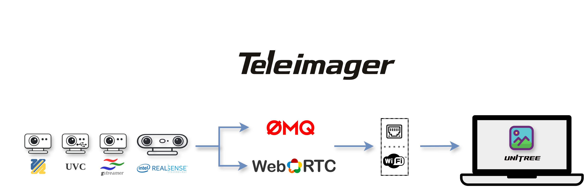

<div align="center">
  
  <a href="https://www.unitree.com/" target="_blank">
    
  </a>
  <p align="center">
    <a href="README.md"> English</a> | <a>中文</a>
  </p>
  <p align="center">
    <a href="https://github.com/unitreerobotics/xr_teleoperate/wiki" target="_blank"> </a> <a href="https://discord.gg/ZwcVwxv5rq" target="_blank"> <a href="https://deepwiki.com/unitreerobotics/teleimager"></a> </a>
  </p>
</div>

[**TeleImager**](https://github.com/unitreerobotics/teleimager) 是宇树（Unitree）的图像服务：**服务端**从多路摄像头（UVC、V4L2、GStreamer、RealSense等）采集视频，并通过 **ZeroMQ** 或 **WebRTC** 发布到网络；**客户端**订阅并解码这些视频流。它为 [xr_teleoperate](https://github.com/unitreerobotics/xr_teleoperate) 提供遥操作视频链路。

## ✨ 特性

- 📸 支持多路 UVC / V4L2 / GStreamer / Intel RealSense 摄像头
- 📢 通过 **ZeroMQ PUB-SUB**（局域网高质量）与 **WebRTC**（低延迟、浏览器）发布视频帧
- 💬 通过 **ZeroMQ REQ-REP** 响应图像配置指令
- 🆔 五种摄像头识别方式：物理路径、序列号、bcd_device、vid_pid、video 路径
- ⚙️ 可配置分辨率与帧率
- 🚀 使用三重环形缓冲区实现高效帧传递

---

## 1. 📦 安装

TeleImager 分为**两种角色**，按需安装即可：

| 角色 | 作用 | 运行位置 |
|------|------|---------|
| **客户端（Client）** | 订阅并解码视频流（遥操作、数据录制、自定义 CV 代码） | 工作站 / 机器人主机 |
| **服务端（Server）** | 从摄像头采集并通过 ZMQ/WebRTC 发布 | 摄像头所连接的机器人设备 |

### 1.0 系统前置依赖（两种角色都需要）

两种角色都通过 **PyTurboJPEG** 做 JPEG 编解码。它是一个 ctypes 绑定,在 import 时加载系统库 **libjpeg-turbo(要求 3.0+)**。这个原生库 pip 无法安装,每台机器安装一次即可。三选一:

**方法 1 —— Conda(推荐,跨平台)**

```bash
conda install -c conda-forge libjpeg-turbo
```

**方法 2 —— Homebrew(macOS)**

```bash
brew install jpeg-turbo
```

<details>
<summary><b>方法 3 —— 从源码编译(Ubuntu/Debian)</b></summary>

```bash
git clone https://github.com/libjpeg-turbo/libjpeg-turbo.git
cd libjpeg-turbo && mkdir build && cd build
cmake -DCMAKE_INSTALL_PREFIX=/opt/libjpeg-turbo ..
make -j$(nproc) && sudo make install
echo 'export LD_LIBRARY_PATH=/opt/libjpeg-turbo/lib64:$LD_LIBRARY_PATH' >> ~/.bashrc
source ~/.bashrc
```

</details>

> ⚠️ **不要**用 PyPI 上那个名为 `turbojpeg` 的包——它是另一个不兼容的库；本项目用的是 `PyTurboJPEG`(已随 `pip install teleimager` 装好)。
> Ubuntu 的 `sudo apt install libturbojpeg` 版本常低于 3.0,因此不推荐。若该库缺失,TeleImager 会在首次 import 时抛出与上面等价的详细安装提示。

### 1.1 环境准备（conda）

```bash
# 安装 Miniconda（已装可跳过）。Jetson/ARM 请用 aarch64 安装包。
mkdir -p ~/miniconda3
wget https://repo.anaconda.com/miniconda/Miniconda3-latest-Linux-x86_64.sh -O ~/miniconda3/miniconda.sh
bash ~/miniconda3/miniconda.sh -b -u -p ~/miniconda3 && rm ~/miniconda3/miniconda.sh
source ~/miniconda3/bin/activate && conda init --all

# 创建并激活项目环境
conda create -n teleimager python=3.10 -y
conda activate teleimager
```

### 1.2 客户端安装

| 需求 | 命令 |
|------|------|
| **无界面（headless）** —— 订阅 ZMQ → BGR `ndarray`（喂给你自己的代码） | `pip install teleimager` |
| **+ 可视化窗口** —— OpenCV 开窗显示 | `pip install "teleimager[viewer]"` |

> 可视化会拉入 `opencv-python`

### 1.3 服务端安装

先按需选后端，再执行下面的安装命令（用 WebRTC 的话最后配一次证书）。

#### 1.3.1 选择后端（摄像头驱动）

「后端」就是 TeleImager 采集某类摄像头所用的驱动，按需叠加：

| 后端（摄像头驱动） | pip 选项 | 说明 |
|------|---------|------|
| 基座（V4L2） | `[server]` | 需要 `v4l2-ctl`：`sudo apt install -y v4l-utils` |
| + UVC | `[uvc]` | 需 USB 权限——安装后执行一次 `sudo "$(which teleimager-server)" --setup-permissions`；wheel 已自带 `libturbojpeg`、`libusb`，无需 apt |
| + RealSense | `[realsense]` |  |
| + 全部（不含 GStreamer） | `[all]` | 等价于 UVC + RealSense |
| + GStreamer | 无 pip 包 | PyGObject + 系统插件——见表格下方的引用块 |

> `type: gstreamer` 是唯一没有 pip extra 的后端：PyGObject 必须跟解释器走，GStreamer 本体来自系统。
>
> ```bash
> conda install -c conda-forge pygobject   # 即 1.1 建的 env；apt 的 python3-gi 只服务系统 python
> sudo apt install gir1.2-gstreamer-1.0 gir1.2-gst-plugins-base-1.0 gstreamer1.0-plugins-base gstreamer1.0-plugins-good
> ```
>
> pipeline 要解 H.264/H.265 再加 `gstreamer1.0-libav`（`avdec_h264`），要硬件解码加 `gstreamer1.0-plugins-bad`；`v4l2src` 和 MJPG-over-RTP 只要 base + good。用 `python -c "import gi; gi.require_version('Gst','1.0'); from gi.repository import Gst; print(Gst.version_string())"` 确认。

#### 1.3.2 安装

选好后端（把下面的 `[server]` 换成对应选项），二选一执行安装：

```bash
# 方式一：从源码（推荐）——顺带获得辅助脚本 setup_autostart.sh 与 WebRTC 资源
git clone https://github.com/unitreerobotics/teleimager.git
cd teleimager
pip install -e ".[server]"        # 如 ".[uvc]"、".[all]"

# 方式二：从 PyPI（不需要辅助脚本时）
pip install "teleimager[server]"  # 如 "teleimager[uvc]"、"teleimager[all]"
```

#### 1.3.3 授予相机访问权限（仅 UVC 需要）

V4L2 开箱即用（`/dev/video*` 带 logind 给的 ACL）；USB video class 不行——节点保持 root 所有，`libusb_open()` 打开 `/dev/bus/usb/...` 会 EACCES。执行一次即可（它写一条 udev 规则、一条 sudoers 条目，并把你加入 `video` 组）：

```bash
sudo "$(which teleimager-server)" --setup-permissions   # $(which ...) 才能在 sudo 的 secure_path 下找到
```

跳过的话，服务端启动时会提示你并给出同一条命令。执行完之后 SSH 需重连，桌面终端需重新登录。

#### 1.3.3 配置 TLS 证书（仅 WebRTC）

详情参见 [CA 说明](https://github.com/unitreerobotics/xr_teleoperate/wiki/CA)。也可用 openssl 快速生成一份自签名证书：

```bash
# 生成一份有效期 365 天的自签名证书（cert.pem / key.pem）
openssl req -x509 -newkey rsa:2048 -nodes -days 365 -keyout key.pem -out cert.pem -subj "/CN=teleimager"
```

生成后，用以下任一方式让 TeleImager 找到它：

```bash
# 方式 A —— 默认配置目录（推荐，与服务端 yaml 同一目录）
mkdir -p ~/.config/teleimager/
cp cert.pem key.pem ~/.config/teleimager/

# 方式 B —— 在命令行指定任意路径
teleimager-server --cert /路径/cert.pem --key /路径/key.pem
```

---

## 2. 🚀 运行服务端

### 2.1 查找已连接的摄像头

按你拥有的摄像头加上对应后端标志扫描（`--uvc`、`--v4l2`、`--gst`、`--rs`，可自由组合）：

```bash
teleimager-server --cf --uvc --v4l2        # RealSense 加 --rs，GStreamer 加 --gst
```

输出示例：

```text
[Teleimager] 🎯 Camera Finder Report
├─ UVCCamera (3 found)   [type: uvc]
│  ├─ 📷 USB HDR Camera (Generic)
│  │  ├─ physical_path : /sys/devices/pci0000:00/0000:00:14.0/usb1/1-3/1-3.1/1-3.1:1.0
│  │  ├─ serial_number : 200901010001
│  │  ├─ bcdDevice     : 0200           (USB device release number)
│  │  ├─ vid : pid     : 1e45:2050      (VendorID : ProductID)
│  │  ├─ video_id      : 0              (/dev/video0)
│  │  └─ modes (MJPG)  [width x height @ fps]:
│  │     ├─ 320x240 @ [30, 60]
│  │     ...
│  │     └─ 1920x1080 @ [30, 60]
│  ├─ 📷 Abham Image (HHWei Technology Co., Ltd.)
│  │  ├─ physical_path : /sys/devices/pci0000:00/0000:00:14.0/usb1/1-1/1-1:1.0
│  │  ├─ serial_number : HHW001
│  │  ├─ bcdDevice     : 0200           (USB device release number)
│  │  ├─ vid : pid     : 1c45:6200      (VendorID : ProductID)
│  │  ├─ video_id      : 10             (/dev/video10)
│  │  └─ modes (MJPG)  [width x height @ fps]:
│  │     ├─ 640x480 @ [5, 10, 15, 20, 25, 30]
│  │     ...
│  │     └─ 2688x1520 @ [5, 10, 15, 20, 25, 30]
│  └─ 📷 Cherry Dual Camera (DECXIN)
│     ├─ physical_path : /sys/devices/pci0000:00/0000:00:14.0/usb1/1-3/1-3.2/1-3.2:1.0
│     ├─ serial_number : 01.00.00
│     ├─ bcdDevice     : 0217           (USB device release number)
│     ├─ vid : pid     : 1bcf:2d4f      (VendorID : ProductID)
│     ├─ video_id      : 2              (/dev/video2)
│     └─ modes (MJPG)  [width x height @ fps]:
│        ├─ 320x232 @ [10, 15, 20, 25, 30, 60, 120]
│        ├─ 640x240 @ [10, 15, 20, 25, 30, 60, 120]
│        ├─ 800x592 @ [10, 15, 20, 25, 30, 60, 120]
│        ├─ 800x600 @ [10, 15, 20, 25, 30, 60, 120]
│        ├─ 1280x480 @ [10, 15, 20, 25, 30, 60, 120]
|        ...
│        └─ 3200x1296 @ [10, 15, 20, 25, 30, 60]
└─ V4L2Camera (4 found)   [type: v4l2]
   ├─ 📷 USB HDR Camera (Generic)
   │  ├─ physical_path : /sys/devices/pci0000:00/0000:00:14.0/usb1/1-3/1-3.1/1-3.1:1.0
   │  ├─ serial_number : 200901010001
   │  ├─ bcdDevice     : 0200           (USB device release number)
   │  ├─ vid : pid     : 1e45:2050      (VendorID : ProductID)
   │  ├─ video_id      : 0              (/dev/video0)
   │  └─ modes  [width x height @ fps]:
   │     ├─ MJPG   1920x1080 @ [60.0, 30.0]
   ...
   │     └─ YUYV   640x480 @ [30.0]
   ├─ 📷 Abham Image (HHWei Technology Co., Ltd.)
   │  ├─ physical_path : /sys/devices/pci0000:00/0000:00:14.0/usb1/1-1/1-1:1.0
   │  ├─ serial_number : HHW001
   │  ├─ bcdDevice     : 0200           (USB device release number)
   │  ├─ vid : pid     : 1c45:6200      (VendorID : ProductID)
   │  ├─ video_id      : 10             (/dev/video10)
   │  └─ modes  [width x height @ fps]:
   │     ├─ MJPG   2688x1520 @ [30.0, 25.0, 20.0, 15.0, 10.0, 5.0]
   ...
   │     └─ YUYV   640x480 @ [30.0]
   ├─ 📷 Cherry Dual Camera (DECXIN)
   │  ├─ physical_path : /sys/devices/pci0000:00/0000:00:14.0/usb1/1-3/1-3.2/1-3.2:1.0
   │  ├─ serial_number : 01.00.00
   │  ├─ bcdDevice     : 0217           (USB device release number)
   │  ├─ vid : pid     : 1bcf:2d4f      (VendorID : ProductID)
   │  ├─ video_id      : 2              (/dev/video2)
   │  └─ modes  [width x height @ fps]:
   │     ├─ MJPG   3200x1296 @ [60.0, 30.0, 25.0, 20.0, 15.0, 10.0]
   ...
   │     ├─ YUYV   640x240 @ [60.0, 30.0, 25.0, 20.0, 15.0, 10.0]
   │     └─ YUYV   320x232 @ [120.0, 60.0, 30.0, 25.0, 20.0, 15.0, 10.0]
   └─ 📷 Intel(R) RealSense(TM) Depth Camera 435i (Intel(R) RealSense(TM) Depth Camera 435i)
      ├─ physical_path : /sys/devices/pci0000:00/0000:00:14.0/usb1/1-11/1-11.2/1-11.2:1.3
      ├─ serial_number : (none)
      ├─ bcdDevice     : 50d0           (USB device release number)
      ├─ vid : pid     : 8086:0b3a      (VendorID : ProductID)
      ├─ video_id      : 8              (/dev/video8)
      └─ modes  [width x height @ fps]:
         ├─ YUYV   424x240 @ [60.0, 30.0, 15.0, 6.0]
         ├─ YUYV   640x480 @ [30.0, 15.0, 6.0]
         ├─ YUYV   1280x720 @ [15.0, 10.0, 6.0]
         └─ YUYV   1920x1080 @ [8.0]
```

### 2.2 启动服务端

根据 2.1 节的相机搜索报告创建服务端 YAML，输出参数及字段注释见 [streaming_config.yaml](streaming_config.yaml)。例如，使用 RealSense 单目头部且无腕部时，将下面的配置与该文件放在同一目录，并替换设备序列号：

```yaml
streaming: streaming_config.yaml
camera:
  head_mono_camera:
    type: realsense
    image_shape: [480, 640]
    binocular: false
    fps: 30
    serial_number: "YOUR_SERIAL_NUMBER"
    enable_depth: false
```

启动时显式指定服务端 YAML：

```bash
teleimager-server --config /path/to/server.yaml
```

也可使用 `TELEIMAGER_CONFIG=/path/to/server.yaml teleimager-server`。`--config` 优先于环境变量；两者都未提供时明确报错，不自动创建或隐式读取服务端配置。相机发现（`--cf`）和权限设置（`--setup-permissions`）不要求配置文件。

`--streaming-config <路径>` 选择输出设置，`--no-affinity` 跳过 CPU 核心绑定，`--isaacsim` 从共享内存读取图像。TLS 证书仍默认读取 `~/.config/teleimager/cert.pem` 和 `key.pem`；客户端仍保留最近一次成功获取的配置缓存。

### 2.3 开机自启动

一切验证无误后，如有需要，可安装为[开机启动服务](setup_autostart.sh)：

```bash
bash setup_autostart.sh        # 按提示填写服务端 YAML 路径
```

---

## 3. 📺 运行客户端

### 3.1 ZMQ 方式

服务端运行后，在另一个终端（或另一台机器）启动客户端，指向服务端 IP：

```bash
teleimager-client --host 192.168.123.164        # 默认：192.168.123.164
```

每路摄像头会各自弹出一个 OpenCV 窗口（需要 `teleimager[viewer]`）。

若做无界面订阅，请参照 [`client.py`](src/teleimager/client.py) 中`TeleImageClient` 的 `# public api` 从自己的代码里订阅。

### 3.2 WebRTC 方式

在浏览器打开服务端的 WebRTC 页面，点击页面中央的 **start** 按钮：

```text
https://<host_ip>:<webrtc_port>        # 例如 https://192.168.123.164:60001
```

---

## 4. 🧠 设计原理

### 4.1 为什么需要五种摄像头识别方式？

当多个摄像头同时接入时，系统需要可靠的方式区分它们。TeleImager 支持五种标识，按优先级查找：

`physical_path > serial_number > bcd_device > vid_pid > video_id`

每种各有优劣，且厂商对这些字段的使用往往与 USB 规范不一致——字段在规范里的"标准含义"和厂商固件实际写入的值可能完全不同。下表基于实际场景。

| 标识 | 含义 | 🎯 优点 | ⚠️ 缺点 |
|------|------|--------|--------|
| **physical_path** | 内核分配的 USB 拓扑路径——插在哪个物理口 | 只要不换口就稳定；不依赖固件；适合固定部署（头部 + 左右腕） | 换 USB 口就要改配置 |
| **serial_number** | USB 描述符中的字符串，规范上每台唯一 | 换口不变，可移植；规范上就是用来区分单台设备的 | 低成本摄像头可能共用、留空或格式异常 |
| **bcd_device** | BCD 固件版本号；部分厂商按单台设备变化 | 固化在固件中，重启/换口不变；厂商有意时可当序列号用 | 很多厂商同型号所有设备取值相同 |
| **vid_pid** | 16 位 供应商:产品 ID | 极稳定；可一眼区分不同型号 | 同型号通常共享同一 vid_pid |
| **video_id** → `/dev/videoX` | 内核枚举的 V4L2 节点编号 | 最直接：填编号 `X` 即可 | 插拔顺序/重启/枚举顺序都会变——多摄像头下不可靠 |

> `bcd_device` 与 `vid_pid` 的粒度完全取决于厂商做法。请先运行 `teleimager-server --cf` 查看实际值再决定用哪个字段。

### 4.2 为什么需要两种传输方式？

服务端有两大用途，对延迟/带宽的要求不同：

- **ZeroMQ PUB–SUB** —— 通过局域网传输。高质量帧、低开销、高吞吐，在不牺牲画质的前提下保持低延迟。适合**录制训练数据**。
- **WebRTC** —— **实时预览**、VR 遥操作、UI 调试。自动码率控制下的低延迟，H.264（默认）/ VP8，兼容浏览器与 VR 设备。

### 4.3 三重环形缓冲区的好处

- **消除画面撕裂** —— 读写永远不落在同一槽位，因此读取者不会读到"写了一半"的帧。
- **始终最新** —— 与 FIFO 队列不同，旧帧会被覆盖，读取者永远拿到最新一帧。对实时性至关重要。

---

## 5. 🧐 FAQ

1. **`--cf` 输出中序列号等字段显示为 `unknown`？**
部分摄像头需要更高权限才能读取完整硬件信息，可尝试：

```bash
sudo $(which teleimager-server) --cf --uvc
```

**启动服务端时报 `No module named 'psutil'`？**
`psutil`（用于可选的 CPU 亲和性调优）已包含在 `teleimager[server]` 中。若你的环境是零散安装导致缺失，执行 `pip install psutil` 补上，或用 `pip install -e ".[server]"` 重装。现在即使缺失也只会打印警告并跳过该优化，不再导致崩溃。

---

## 6. 🙏 Acknowledgement

部分代码参考了 https://github.com/ARCLab-MIT/beavr-bot

## RoboTree 定制功能

版本 `2.0.5+robotree.1`，公版源码基线为 `b80649fbb6520d24aeb767e28d608ec08b60a20d`。

- `camera.<topic>.type: rtp` 每个实例接收一条 RTP/JPEG 或 RTP/H264 流，用 `rtp_port` 选择端口并按 `source_host` 过滤。左右眼独立发布、独立恢复，不配对、不拼接；过期帧停止输出。
- 顶层 `app_stream` 支持 RoboTree App H264/TCP 直连、单画面、拼接及 `stereo_quad` 四宫格；控制端口默认 `13579`，图像连接使用 App 请求的地址和端口。
- App BGR 输出独立于 WebRTC；四宫格对缺失、过期画面显示占位。公版客户端 `teleimager.client.TeleImageClient` 保持原实现。

`stereo_quad` 的 `app_stream.camera_topics` 使用 `head_mono`、`head_stereo`、`head_left`、`head_right`、`wrist_left`、`wrist_right` 角色映射话题。单话题头部仅在采集配置声明 `binocular: true` 时拆分；单目完整复制到两个眼格，独立双眼分别读取。App 拼图只选择单目头部、拼接双目或独立双眼中的一种来源。所有声明话题使用独立的 ZMQ 和 WebRTC 端口。只初始化已配置相机，无腕部时保留占位格且不启动腕部输出；所有组合共用 `streaming_config.yaml`。

统一输出参数及字段说明见 [streaming_config.yaml](streaming_config.yaml)。`configs/drivers/teleimager/real/<body>/<part>/<vendor>/<selection>.yaml` 在内联 `camera_config` 中保存单台相机输入参数；目录和流名不推导采集参数。实验通过 `streaming_config` 显式选择统一的 `streaming_config.yaml`。文件包含同级的 `zmq`、`tcp`、`webrtc` 区块，各自配置 `enabled`、`codec` 和输出参数。Runtime 只将 ZMQ 设置用于连接校验与指纹；Docker 应用全部输出，预览参数变化不改变 Runtime 身份。统一启动参数为 `--streaming-config`，临时覆盖变量为 `TELEIMAGER_STREAMING_CONFIG`。TCP 的尺寸、FPS、码率与编码选项以推流文件为准，App 提供接收端点并须使用匹配的解码尺寸。`python -B docker/pc4/service.py print-config` 导出最终静态配置，不打开设备。

定制 RTP/App 路径需要 OpenCV（可安装已有的 `[viewer]` extra）。RTP/JPEG 还需 `gst-launch-1.0` 及 `rtpjitterbuffer`、`rtpjpegdepay`、`jpegparse` 插件，不使用通用 GStreamer 后端的 Python GI binding。

### 源码职责

`server.py` 提供 `TeleImageServer` 和服务端 CLI，`client.py` 提供 `TeleImageClient` 和客户端 CLI。`TeleImage`、`TripleRingBuffer` 从 `teleimager.frame` 导入，通信类从 `teleimager.transport` 下各实现模块导入；客户端和服务端不再转导出已移入这些模块的实现。现有命令名保持可用。

不再支持命名相机 `profiles`、`read_config(profile=...)` 参数及逐相机 `{config, profile}` 选择。原生相机使用完整参数字典或普通相对 YAML 引用；RoboTree 在 `camera_config` 中内联采集参数，再导出原生运行配置。客户端缓存、协议恢复和已支持的相机后端保持可用。

| 模块 | 职责 |
| --- | --- |
| `camera/camera.py` 及各后端文件 | 公共采集生命周期与逐后端实现 |
| `camera_finder.py` | 相机发现及报告 |
| `transport/zmq_publisher.py` | ZMQ 发布线程与管理 |
| `transport/zmq_subscriber.py` | ZMQ 订阅、FPS 统计和 JPEG 解码 |
| `transport/zmq_request.py` | 配置请求、响应和客户端缓存 |
| `transport/webrtc.py` | WebRTC 发布、编码设置及浏览器页面 |
| `transport/tcp_stream.py` | Robotree App TCP 控制、H264 推流及预览布局 |
| `frame.py` | 共享图像数据与最新帧缓冲 |
| `host.py` | 驱动重载、权限设置和 CPU 亲和性 |

服务端直接引用共享通信模块，不再依赖客户端模块。WebRTC 编码器补丁在构造服务端时应用，不在模块导入时修改；页面 Logo 使用包资源定位。App 推流使用 `teleimager.transport.tcp_stream.TcpStreamServer`，不再提供原模块路径和类名。
